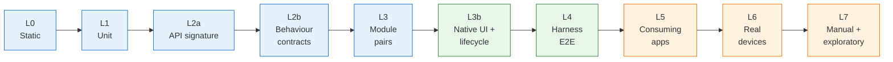
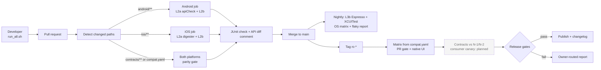

# Mobile SDK Quality Engineering – Proposal

**Role:** Senior Mobile QA Engineer (Platform / SDK) · **Status:** DRAFT v0.3
**Companion files:** [`risk-matrix.md`](risk-matrix.md) (full risk analysis) · [`PROMPT_LIBRARY.md`](PROMPT_LIBRARY.md) (AI prompts) · [code repository](https://github.com/ricardorlg/sdk-qa-assignment)

---

## Introduction

**The situation.** I am the QA of a team building an SDK made of several modules. Some modules belong to other teams. The SDK is already used by existing apps and will be used by a new app. Five problems are named in the brief: module updates affect other modules or apps, iOS and Android behave differently, E2E tests are slow and flaky, version compatibility is unclear, and integration problems are found late and are hard to attribute.

**What I built to support the proposal.** A small, deliberately simple *dummy SDK*: an **authentication module** (login, token refresh, logout, session restore) written natively in **Swift** and **Kotlin**, plus a scripted fake auth server, a minimal host app per platform, and the CI that tests them ([repository](https://github.com/ricardorlg/sdk-qa-assignment)). It is not a real SDK. It exists so that the strategy is *demonstrated* and not only described: every layer marked **Built** below can be run and its behaviour seen in a pull request. Authentication was chosen because it is high risk, every module depends on it, and its error semantics tend to drift between platforms.

**How the document maps to the assignment**

| Assignment point | Section | Code in the repo? |
|---|---|---|
| 1. Test strategy | [§1](#1-test-strategy) | Partly: contracts, native UI and compatibility are built; the rest is described |
| 2. Automation example | [§2](#2-automation-example) | Yes, with links to each demo |
| 3. CI/CD and release validation | [§3](#3-cicd-and-release-validation) | Yes for the PR gate and nightly UI; release jobs are stubs |
| 4. Investigation scenario | [§4](#4-investigation-scenario) | No (a method, not code) |
| 5. First three priorities | [§5](#5-initial-priorities) | No |
| Beyond the brief | [§6](#6-future-improvements) future improvements · [§7](#7-risks-trade-offs-and-ai-usage) risks, trade-offs, AI usage | — |

**Status legend used throughout:** **Built** = code exists and ran in CI · **Described** = strategy only; how I would do it, left as future work.

**Key assumptions** (none is known from the brief; I would validate them in the first two weeks)

| # | Assumption | If wrong |
|---|---|---|
| A1 | The SDK ships as versioned modules (SPM/CocoaPods, Maven/Gradle), SemVer, each module versioned independently | Add a release-train step to the compatibility policy |
| A2 | About 3 consuming apps (2 existing, 1 new); apps pin exact SDK versions and upgrade every 1 to 3 releases | Fewer apps: the canary becomes the main gate. More apps: contracts matter even more |
| A3 | Native implementation per platform; no shared behavioural spec today | If shared code (KMP) exists, parity risk drops and L2b focuses on the bridge |
| A4 | Existing automation is mostly UI/E2E, run nightly, with no flake data | Priority 1 produces the real numbers and re-scores the risks |
| A5 | The SDK ships some UI (login, consent) and handles session and lifecycle | If headless, L3b shrinks to lifecycle only |
| A6 | A device farm (BrowserStack, Firebase, AWS) is available on budget; there is no in-house device lab | Real-device coverage is cut to a smaller, pre-agreed set |
| A7 | There is a staging backend, and test accounts can be created | L4 uses the fake server only |

**Time assumptions.** The numbers below are *working budgets*, not measurements of the client's system. The measured column is from the demo repo on GitHub-hosted runners.

| Item | Assumption / budget | Measured in the demo |
|---|---|---|
| Release cadence | Release candidate (RC) every 2 to 4 weeks; apps ship on their own train | — |
| PR gate | under 15 min, blocking | 1.5 to 3 min (L2a + L2b only) |
| Nightly native UI | under 60 min for the whole OS matrix | Android 6 to 7 min, iOS 11 min per job |
| RC validation | under 2 h, including canary and real devices | not built |
| Investigation | contain in the first hour; reproducible failure within a day | — |
| Onboarding and first outcomes | 30 days listening; outcomes at about 2, 4 and 6 weeks (§5) | — |

**Timebox and what I left out.** The exercise was timeboxed, so I put the effort where the risk analysis says it pays most: *contracts, compatibility and fast CI*. I intentionally did not build: a broad UI/E2E suite, device-farm integration, the consumer canary, performance and security suites, or Pact with a broker. They are described and listed as future work.

**Risk analysis.** Test effort follows *impact × probability*, not equal coverage. The full register (15 risks, failure-mode analysis, coverage per risk zone) is in [`risk-matrix.md`](risk-matrix.md). Scores are expert judgement because no incident history exists; Priority 1 re-scores them from real data. The main conclusion: the biggest risks are *change* risks (breaking consumers, platform drift, version mismatch, concurrency), not feature bugs. The strategy therefore invests in contracts and compatibility rather than in more UI tests.

| ID | Risk | I×P | Zone | Primary control |
|---|---|---|---|---|
| R1 | API or behaviour change breaks consuming apps | 5×4=**20** | CRITICAL | L2a signature + L2b consumer contracts |
| R2 | iOS and Android behave differently | 4×4=**16** | CRITICAL | Shared scenarios, parity gate |
| R4 | Incompatible module or dependency versions | 4×4=**16** | CRITICAL | `compat.yaml` matrix, contracts vs N-1/N-2, canary |
| R5 | Concurrency and init order at module boundaries | 4×4=**16** | CRITICAL | Parallel scenarios, TSan, module-pair integration |
| R3 | Token lifecycle defects | 5×3=**15** | CRITICAL | Auth scenarios + L3b lifecycle |
| R8 | Flaky or slow tests erode trust | 3×5=**15** | CRITICAL | Retry-and-flag, quarantine, time budgets |
| R14, R15 | Upgrade breaks stored session · OEM and device-specific behaviour | 12 | HIGH | Previous-release fixtures · real-device tier |

---

## 1. Test strategy

**Key message:** native, fast layers at the base; contracts as the backbone; slow cross-app tests only where they cover a risk nothing below can. Each layer answers one question, and a failure points at one place.

### 1.1 The layers at a glance



Blue = every PR · green = nightly · orange = release candidate. The fake server and shared scenarios feed L2b and L3b.

| Layer | Question it answers | Runs | Owner | Status |
|---|---|---|---|---|
| L0 Static checks | Is the code well formed and the dependencies sane? | Every PR | Module teams | Described |
| L1 Module unit | Does one module's logic work with its boundaries mocked? | Every PR | Module teams | Described |
| **L2a API signature contract** | Did the public API change in a way consumers will notice? | Every PR | Platform team | **Built** |
| **L2b Behaviour contracts** | Does the SDK still behave the way consumers rely on, on both platforms? | Every PR | Platform + app teams | **Built** |
| L3 Module integration pairs | Do module A and module B work together (real DI, fake backend)? | Affected pairs on PR, all nightly | Module teams | Described |
| **L3b Native UI and device lifecycle** | Do SDK screens, rotation, background, kill and relaunch work on a real OS? | Nightly (PR if UI or storage paths change) | Platform team | **Built** |
| L4 E2E on the harness app | Do full journeys work against a real staging backend? | Nightly | QA | Described |
| L5 Consuming apps | Does the RC work inside the real apps, and does upgrading keep sessions? | RC (smoke also nightly) | App teams + QA | Described |
| L6 Real-device tier | Does it work on OEM hardware and under memory or battery pressure? | RC | QA | Described |
| L7 Manual and exploratory | What did we not think to automate? | RC and on new capability | QA + devs | Described |

Time budgets are working assumptions (see Introduction). Native tooling is used on L1 to L4 for fidelity and speed; Appium appears only in L5 for a few critical journeys.

### 1.2 Layer by layer

**L0 Static checks (Described).** Lint (SwiftLint, ktlint/detekt), dependency-graph checks (lockfile diff, unexpected transitive changes), secret scanning. Cheapest signal; runs first on every PR.

**L1 Module unit tests (Described).** Each module team tests its own logic with mocks at the module boundary (XCTest/Swift Testing; JUnit + MockK). QA provides templates and review but does not write them. PR rule: new business logic ships with unit tests. Target: coverage by risk zone, not a blanket number.

**L2a API signature contract (Built).** Catches *interface* breaks before consumers see them.
- Android: `binary-compatibility-validator` dumps the public API to a versioned `.api` file; `apiCheck` fails if the API changed without a reviewed `apiDump`.
- iOS: a committed `.swiftinterface` baseline is diffed, and `swift-api-digester` compares against the last release tag (`v1.0.0` in the demo) to classify breaks.
- Rule: an undeclared API change fails the PR; a removal or rename cannot ship as minor or patch (SemVer).

**L2b Behaviour contracts (Built).** Catches *behaviour* breaks that keep the same signature.
- **Core scenarios:** one declarative JSON file, run by a Swift runner and a Kotlin runner against the same fake server. Drift between platforms becomes a failing test.
- **Consumer-driven scenarios:** each consuming app contributes scenarios describing *how* it relies on the SDK (for example "a valid token is reused without a server call"). They live in `contracts/consumers/<app>/` inside the SDK repo and run in SDK CI. `CODEOWNERS` makes the consuming team the owner of its folder.
- **Policy:** a failing consumer scenario blocks the SDK PR; it is unblocked by the owning team's approval or a major bump with a migration note.
- **Trade-off:** more friction on SDK PRs, in exchange for feedback in minutes and a smaller canary. Pact with a broker is the heavier option and is postponed (it is HTTP-centric and needs infrastructure).

**L3 Module integration pairs (Described).** Two or more real modules with real DI and a fake backend, on the JVM or macOS. Which pairs run on a PR comes from `compat.yaml` (the modules that depend on the changed one); all pairs run nightly, with Thread Sanitizer. This is where "A and B together" failures live (R4, R5), and it is the suite the investigation in §4 would extend.

**L3b Native UI and device lifecycle (Built).** An SDK that ships screens or reacts to lifecycle cannot be trusted on logic tests alone. A minimal host app *inside the SDK repo* (the SDK test harness app, the same one L4 reuses) runs on an emulator or simulator and covers: SDK-rendered login UI, rotation and activity recreation, background and foreground, process kill and relaunch (session restored from secure storage), and storage on a real OS. It is not E2E: the backend is the fake server, only the SDK surface is driven, and there are a handful of deterministic tests per capability (idling resources, no sleeps). Visual regression and OEM quirks belong to L6 and L7.

**L4 E2E on the SDK test harness app (Described).** The same host app as L3b, now pointed at a *staging* backend with test accounts. The difference from L3b is the backend and the scope, not the tool: L3b drives the harness against the fake server, L4 runs full journeys against real infrastructure. A small number of full journeys (login, use a protected resource, token expiry in a real session, logout, re-login). Purpose: catch what the fake server cannot, such as a real backend change or a certificate or clock issue. It runs nightly and not on PRs because it is slower and depends on a shared environment. Any failure is first classified (product, dependency, test, environment; §4) before it reaches a developer.

**L5 Consuming apps: regression, canary and upgrade (Described).** The SDK team does not own the apps' suites but depends on them to see integration breakage.

| | Existing apps (in production) | New app (pre-release) |
|---|---|---|
| Starting point | Have regression suites, unknown health | No automation, highest uncertainty |
| What the SDK team asks | A small SDK-facing smoke tagged `@sdk-smoke` (login, session restore, one flow per module), runnable against any SDK build | The same smoke from day one, written with the app team; plus component tests with the SDK real and the backend faked |
| When it runs | RC and nightly, in the app's own pipeline, with the SDK version as an input | Every app PR that touches SDK usage, and the RC |
| Failure ownership | App team triages first, using my report; a *differential run* (RC vs previous SDK) tells SDK regressions from app changes | I pair with the app team until the suite is stable |

The new app is the best early signal: it exercises the newest modules and combinations nobody has run before, so I would embed with that team for its first release. Two further checks live here:
- **Consumer canary:** build each app with the RC and with the previous SDK; failing only on the RC isolates SDK regressions.
- **Upgrade-in-place test (R14):** install the app with SDK N-1, log in, install over it with SDK N, assert the session is still valid (`adb install -r` on Android; install over on the iOS simulator). The contract suite also keeps a *persisted-state fixture* written by the previous release, which the new version must restore or migrate explicitly.

**L6 Real-device tier (Described).** Simulators miss OEM behaviour, so this tier runs on a device farm for release candidates only. Devices are chosen by risk, not by count, and the list is data-driven (top devices and OS versions from the apps' analytics, reviewed quarterly; without analytics, Android market-share leaders in the target regions plus the two latest iOS majors).

| Tier | Where | What | Why |
|---|---|---|---|
| T0 | Simulator/emulator, every PR | Min and max supported OS, one phone size | Fast, cheap; catches logic and lifecycle |
| T1 | Simulator/emulator, nightly | Full OS list, tablet sizes, dark mode, large font, RTL | Layout and OS-behaviour drift (R7) |
| T2 | Real devices, RC | Android: Samsung (One UI), Xiaomi (MIUI/HyperOS), Pixel, one low-RAM device. iOS: oldest supported device, current and previous OS, one small screen | OEM battery and background limits kill processes and clear state; keystore and Keychain differ on hardware; memory pressure |
| T3 | By hand, RC | Network switching, interruptions, OS beta | What automation cannot simulate faithfully |

**L7 Manual regression and exploratory testing (Described).** Automation checks what we already know; exploratory testing finds what we do not. Both are scheduled, not ad hoc.

| Type | When | Who | Examples | Output |
|---|---|---|---|---|
| Session-based exploratory (60 to 90 min, charter, notes) | Per RC, and when a new module lands | QA, paired with a module developer and an app-team member | New module inside the new app · session expiry mid-flow · airplane mode during refresh · app killed during login · OS beta · OEM battery saver on · VoiceOver/TalkBack and font scale · PII in logs | Bugs, new scenario candidates for L2b, next charters |
| Manual regression checklist (about 20 risk-ranked checks) | Per RC on T2 devices | QA | Login, restore, logout, token expiry, upgrade-in-place, deep link, permissions, low memory, rotation | Pass/fail per device; anything repeated twice gets automated |
| Bug bash | Before the new app's first release | Everyone touching the SDK and the app | Free exploration, shared sheet | Fresh-eyes defects, usability issues |

**Rule:** any defect found manually leads to a regression check at the lowest sensible level (usually an L2b scenario). Exploratory effort should shrink for known areas and move to new ones.

### 1.3 How the SDK is tested through its life cycle

| Stage | What runs | Gate | Who sees the result |
|---|---|---|---|
| Developer, locally | `run_all.sh` (L2 in seconds); L0 and L1 | none | Developer |
| Pull request | L0, L1, L2a, L2b, affected L3 (path-aware, per platform) | **Blocking**, under 15 min | PR author, module owner, consumer owners |
| Merge to main | Same gate again plus change log entry | Blocking | Platform team |
| Nightly | L3 all pairs with TSan, L3b on the full OS matrix, L4, flaky report | Non-blocking, triaged next morning | QA, module teams |
| Release candidate | Everything above, contracts vs N-1/N-2, L5 canary and upgrade test, L6, L7, release checklist | **Blocking** | Release manager (go/no-go) |
| After release | Crash-free and auth-error rates, staged rollout by app, support channel | Rollback or hotfix criteria | Platform team |

### 1.4 Versions and compatibility (R4)

- **`compat.yaml` is the source of truth** for SDK version, per-module versions and dependencies, supported OS versions, and each consuming app's pins. `tools/gen_matrix.py pr|rc` turns it into CI jobs (min and max OS on a PR; full OS list, previous releases and canary on an RC) and rejects a consumer pinning an unknown module.
- **SemVer per module.** Public API or behaviour break = major; additive = minor; fix = patch. L2a enforces this mechanically.
- **Umbrella version = known-good set.** The SDK version pins a tested set of module versions; apps pin the umbrella unless they opt out and accept the risk.
- **Support window:** N and N-1 majors fully supported, N-2 security fixes only. Every supported combination is in the contract-vs-release matrix; anything else is "unsupported" and published as such.
- **Deprecation:** deprecated API stays one minor release with a compiler warning and a migration note; apps are told at deprecation, not at removal.
- **Published matrix and changelog:** each release states what changed, which consumer scenarios were touched, supported combinations, and whether storage formats changed (safe to roll back or not).
- **Hotfix:** a patch can be cut from the last tag; the previous umbrella version stays downloadable.

### 1.5 Ownership and communication

Most integration failures are coordination failures first. The pipeline makes them visible; these agreements prevent them.

| Who | Owns | QA's role |
|---|---|---|
| Module teams (mine and others) | Module code, L1/L3 tests, their part of the shared scenarios | Provide platform, templates and review; do not write their tests for them |
| SDK platform team | API surface, L2a/L2b gates, `compat.yaml`, release train | Owner of strategy, matrix and flake dashboard |
| App teams (existing and new) | Their `contracts/consumers/<app>/` files, `@sdk-smoke` suite, app journeys | Pair on first scenarios; triage with the failure report |
| Release manager | RC cut, go/no-go | Provide gate report and risk summary, not the decision |

- **Definition of done for a module change** (including other teams' modules): unit tests; a contract scenario for any behaviour a consumer can see; API diff reviewed; changelog with affected consumers; no new flaky test; both platforms covered or a tracked parity exception.
- **Rituals (reusing existing meetings where possible):** weekly 30-min compatibility triage (breaking changes, deprecations, top flakes); consumer scenarios and API changes reviewed in the PR via CODEOWNERS; 15-min RC readiness check; blameless post-mortem for every escaped defect (which layer should have caught it, plus one new test at the lowest level).
- **Disagreement:** if a module team thinks a consumer scenario over-specifies behaviour, it is discussed in the PR with the app team; the scenario stays until agreed, and any override has an expiry date.

### 1.6 Quality gates and KPIs

| Gate | Pass criteria |
|---|---|
| PR | L2a clean or reviewed dump; L2b green on affected platforms; no new flaky test; owners approved |
| Release | All L1 to L3b green and no quarantined test on changed modules; compatibility matrix green; each in-scope app builds and passes smoke against the RC; zero open P1/P2 regressions |

| KPI | Target | Cadence |
|---|---|---|
| Time to signal (PR) | under 15 min | Weekly |
| Flake rate | under 2% of runs | Weekly |
| Escaped integration defects per release | decreasing trend | Per release |
| Share of public API covered by a scenario | rising; 100% for CRITICAL modules | Monthly |
| Supported-matrix coverage | 100% of supported combinations at RC | Per RC |
| Time from failure to named owner | under 1 working day | Monthly |

Metrics are used to re-score the risk register and to find where to invest, not to rank teams. The strategy is reviewed quarterly and after any escaped defect, new module, or team change.

---

## 2. Automation example

**Key message:** one contract, two native runners. Adding a case is one JSON edit, and platform drift becomes a failing test. Everything in this section is code in the [repository](https://github.com/ricardorlg/sdk-qa-assignment); what is not coded is stated as future work.

### 2.1 The demos and what each one proves

| # | Demo | Layer | What it tests | Code |
|---|---|---|---|---|
| D1 | **Shared behaviour contracts** | L2b | 10 scenarios per platform from one JSON file, run by a Swift and a Kotlin runner against a scripted fake server. The scenarios are: login, invalid credentials, transparent refresh, rejected refresh ends the session, 503 during refresh keeps the session, timeout keeps the session, malformed body maps to `serverError`, **concurrent refresh is single-flight**, logout, and one consumer scenario | [`contracts/auth/scenarios.json`](https://github.com/ricardorlg/sdk-qa-assignment/blob/main/contracts/auth/scenarios.json) · [`fake-auth-server/server.js`](https://github.com/ricardorlg/sdk-qa-assignment/blob/main/fake-auth-server/server.js) · [iOS runner](https://github.com/ricardorlg/sdk-qa-assignment/blob/main/ios/Tests/AuthContractTests/AuthContractTests.swift) · [Android runner](https://github.com/ricardorlg/sdk-qa-assignment/blob/main/android/src/test/kotlin/sdk/auth/AuthContractTest.kt) |
| D2 | **Consumer-driven contract** | L2b | A scenario owned by a consuming app (`retail-app`): a valid token is reused without a server call. `CODEOWNERS` assigns the folder to the app team | [`contracts/consumers/retail-app/auth.json`](https://github.com/ricardorlg/sdk-qa-assignment/blob/main/contracts/consumers/retail-app/auth.json) · [`.github/CODEOWNERS`](https://github.com/ricardorlg/sdk-qa-assignment/blob/main/.github/CODEOWNERS) |
| D3 | **API signature contract** | L2a | Android: `apiCheck` against the committed `.api` dump. iOS: `.swiftinterface` diff plus `swift-api-digester` against tag `v1.0.0`. Failures are posted as a diff in the job summary and as a PR comment | [`android/api/auth-sdk-android.api`](https://github.com/ricardorlg/sdk-qa-assignment/blob/main/android/api/auth-sdk-android.api) · [`ios/api/AuthSDK.swiftinterface`](https://github.com/ricardorlg/sdk-qa-assignment/blob/main/ios/api/AuthSDK.swiftinterface) · [`tools/ios_api.sh`](https://github.com/ricardorlg/sdk-qa-assignment/blob/main/tools/ios_api.sh) · [`tools/ci_api_report.sh`](https://github.com/ricardorlg/sdk-qa-assignment/blob/main/tools/ci_api_report.sh) |
| D4 | **Native UI and lifecycle** | L3b | 4 Espresso and 4 XCUITest tests in a host app: SDK login screen, rotation or recreation, background and foreground, kill and relaunch with the session restored from secure storage | [Android](https://github.com/ricardorlg/sdk-qa-assignment/blob/main/android-instrumented/app/src/androidTest/kotlin/sdk/auth/ui/AuthLifecycleTest.kt) · [iOS](https://github.com/ricardorlg/sdk-qa-assignment/blob/main/ios-host/UITests/AuthLifecycleUITests.swift) |
| D5 | **Compatibility manifest** | Versions | `compat.yaml` and a generator that expands it into CI matrices (`pr` or `rc`) and validates consumer pins | [`compat.yaml`](https://github.com/ricardorlg/sdk-qa-assignment/blob/main/compat.yaml) · [`tools/gen_matrix.py`](https://github.com/ricardorlg/sdk-qa-assignment/blob/main/tools/gen_matrix.py) |
| D6 | **Flaky-test handling** | Reliability | Retry once; a pass on retry is reported as FLAKY (warning, job summary and a PR comment), never silently green. Wired into the PR Gate and the nightly UI jobs; shown by PR #6 | [`tools/retry_flag_flaky.sh`](https://github.com/ricardorlg/sdk-qa-assignment/blob/main/tools/retry_flag_flaky.sh) |
| D7 | **Six demo pull requests** | CI | Each PR changes one thing, to show which layer catches it (§2.3) | [PRs #1 to #6](https://github.com/ricardorlg/sdk-qa-assignment/pulls) |

How a scenario looks (abridged): it scripts the fake token endpoint, drives the client, and states expected results and final state. Expiry is driven by `expires_in` and slowness by `delayMs`, so there are no sleeps.

```json
{ "id": "concurrent_refresh_is_single_flight",
  "tokenEndpointResponses": [
    { "status": 200, "body": { "access_token": "a1", "refresh_token": "r1", "expires_in": 0 } },
    { "status": 200, "delayMs": 200, "body": { "access_token": "a2", "refresh_token": "r2", "expires_in": 3600 } } ],
  "steps": [
    { "action": "login", "username": "user", "password": "secret", "expect": { "ok": true } },
    { "action": "parallel", "calls": [
      { "action": "getAccessToken", "expect": { "token": "a2" } },
      { "action": "getAccessToken", "expect": { "token": "a2" } },
      { "action": "getAccessToken", "expect": { "token": "a2" } } ] } ],
  "final": { "authenticated": true, "tokenRequests": 2 } }
```

### 2.2 What running it found

| Check | Result |
|---|---|
| 10 contract scenarios, iOS and Android | Pass on both |
| Concurrent refresh (new scenario, run *before* fixing the code) | **Failed on both platforms**: duplicate refreshes. Fixed with an in-flight task (Swift) and a lock (Kotlin) |
| Malformed response body (new scenario, run before fixing) | **Failed on Android only**: a `JSONException` escaped. Mapped to `serverError` |
| Injected iOS-only bug (503 treated as session expiry) | Caught by `server_error_keeps_session` |
| Keychain replaced by an in-memory store | The relaunch test fails, so the test is sensitive |
| L3b native tests | Pass locally and on GitHub-hosted runners (Android API 29 and 36, iOS 18.5); iOS 26.2 failed once and was not investigated |

### 2.3 Demo pull requests: quick feedback in practice

Each PR is a separate branch in the private repo. The PR Gate reports which layer catches the change in about 1.5 to 3 minutes and runs only the platform whose paths changed.

| PR | Platform | What it breaks | L2a signature | L2b behaviour | Why |
|---|---|---|---|---|---|
| [#1](https://github.com/ricardorlg/sdk-qa-assignment/pull/1) | Android | public `login` renamed to `signIn` | **fails** (`apiCheck` diff) | fails (runner no longer compiles) | Breaking API change |
| [#2](https://github.com/ricardorlg/sdk-qa-assignment/pull/2) | iOS | single-flight refresh removed (internal) | passes | **fails** | Signature unchanged, behaviour regressed; Android stays green, so the bug is iOS-only |
| [#3](https://github.com/ricardorlg/sdk-qa-assignment/pull/3) | iOS | new public property `hasSession` | **fails** (diff) | passes | Additive change: needs review, but the digester does not call it breaking |
| [#4](https://github.com/ricardorlg/sdk-qa-assignment/pull/4) | Android | refresh lock removed (internal) | passes | **fails** | Same bug class as #2, on Android |
| [#5](https://github.com/ricardorlg/sdk-qa-assignment/pull/5) | iOS | `KeychainSessionStore.init(service:)` becomes `init(keychainService:)` | **fails** | passes | `swift-api-digester` vs `v1.0.0`: "init(service:) has been removed" (breaking) |

| [#6](https://github.com/ricardorlg/sdk-qa-assignment/pull/6) | Android | adds a test that fails once and passes on retry (simulated race) | passes | passes, **flagged FLAKY** | Job stays green but is not a clean pass: warning, job summary and a sticky PR comment ask for investigation before any quarantine (§3.4) |

L2a and L2b catch different things and both are needed: #2 and #4 are invisible to L2a, and #3 and #5 are invisible to L2b. #6 is neither: it shows how an unstable test is surfaced instead of hidden.

### 2.4 Not coded (future work)

| Idea | How I would do it |
|---|---|
| L1 module unit tests and L3 module-pair tests | Same fake server and DI; pair tests chosen from `compat.yaml` dependencies and run with Thread Sanitizer |
| Persisted-state fixture and upgrade-in-place test | Commit a session blob written by the previous release; restore it in the new version; for the app-level test, install N-1 then N over it |
| L4 harness E2E against staging | Point the host app at a staging URL with test accounts; 3 to 5 journeys |
| Consumer canary and `@sdk-smoke` | Build each app with the RC and with the previous SDK; run a tagged smoke in the app's own pipeline |
| Real-device runs | Run the existing Espresso and XCUITest on a device farm (§3, future work) |
| Parity report | Publish per-scenario pass/fail per platform in one table |
| Mutation testing on the contract runners | Prove the scenarios fail when the code is wrong (the manual fault injections above are a first, partial version) |

**Limitations of the example.** `AuthClient` classes are minimal stand-ins. The Android store uses `SharedPreferences`, not Keystore. The Android cold-start test simulates a new process. SwiftPM's API-breakage tool does not support iOS targets, so the iOS check is a committed `.swiftinterface` baseline plus `swift-api-digester`. The baseline text depends on the Xcode version, so it is regenerated from the CI toolchain and a toolchain upgrade needs a reviewed baseline update. The digester runs in ABI mode and its "new API without @available" notices are ignored because additive API is not breaking. Swift Testing reports the 10 scenarios as one parameterised test in JUnit, so the failing scenario is read from the log.

---

## 3. CI/CD and release validation

**Key message:** fast, blocking gates on every PR; breadth (OS matrix, canary, real devices) on nightly runs and release candidates; every failure carries an owner and a cause category.

### 3.1 The pipeline



Solid boxes are built and ran on GitHub; the dashed box is a stub.

### 3.2 The three workflows

Each stage of the cycle is its own file in `.github/workflows/`.

| Workflow | Trigger | What it does | Status |
|---|---|---|---|
| **PR Gate** ([`pr.yml`](https://github.com/ricardorlg/sdk-qa-assignment/blob/main/.github/workflows/pr.yml)) | Every PR | Path-aware (`dorny/paths-filter`): Android job only if `android/**` changed, iOS job only if `ios/**` changed, both if `contracts/**`, `fake-auth-server/**` or `compat.yaml` changed. Each job runs L2a and L2b (L2b still runs when L2a fails, so one run shows every problem) and publishes a JUnit check, a job summary and a sticky PR comment with the API diff | **Built**, verified on `ubuntu-latest` and `macos-26` |
| **Native UI** ([`ui-native.yml`](https://github.com/ricardorlg/sdk-qa-assignment/blob/main/.github/workflows/ui-native.yml)) | Nightly, manual | Espresso and XCUITest over the OS matrix generated from `compat.yaml`; flaky-report artifact | **Built**; Android API 29 and 36 and iOS 18.5 passed, iOS 26.2 failed once (not diagnosed) |
| **Release Validation** ([`release.yml`](https://github.com/ricardorlg/sdk-qa-assignment/blob/main/.github/workflows/release.yml)) | Tag `rc-*`, manual | Calls the PR gate and the native UI matrix, then contract-vs-previous-releases and consumer canary | Gate and UI reuse the other workflows; the last two jobs are **stubs** |

Design choices:
- **UI tests are deliberately not a PR gate** (6 to 16 min per job). They run nightly and on RCs, and could become a PR gate for UI, storage and session paths once their duration is acceptable.
- **Failures are readable where developers look:** the API diff appears in the job summary and as a PR comment; test results appear as a JUnit check (`action-junit-report` with `comment: true`); each report states module and version, platform and cause category.
- **Hosted macOS minutes are costly**, which is another reason for path filtering.
- Actions are on their latest major versions, and the macOS runner is `macos-26`, the newest label GitHub offers today.

### 3.3 Gates

- **PR gate (blocking, target under 15 min; measured 1.5 to 3 min for the built subset):** L2a unreviewed API change fails · L2b failing consumer scenario blocks · a change to `contracts/` runs both platform runners (parity gate).
- **Release gates (blocking):** all L1 to L3b green and no quarantined test on changed modules · compatibility matrix green · every in-scope app builds and passes smoke against the RC · zero open P1/P2 regressions · coverage and mutation score on changed code do not drop.

### 3.4 Slow or unstable tests

- `tools/retry_flag_flaky.sh`: retry once; a pass on retry is reported as FLAKY, never silently green. Built into the PR Gate and shown by [PR #6](https://github.com/ricardorlg/sdk-qa-assignment/pull/6): green job plus a PR comment. Caveat: the JUnit report only shows the passing attempt, which is why the flag is a separate signal.
- Auto-quarantine after a flake-rate threshold: non-blocking, with an owner and a 2-week expiry (fix or delete). Before quarantining, check that the flake is not a real race (see §4).
- Slow tests move down the pyramid or to nightly; each stage has a time budget.

### 3.5 Future work for CI/CD

| Item | Why and how |
|---|---|
| **Device farm** (Firebase Test Lab, BrowserStack, AWS Device Farm) | Real-device tier T2 on RCs; run the same Espresso and XCUITest bundles; choose devices from analytics |
| **Slack (or Teams) notifications** | Nightly and RC summaries to a quality channel, tagging the owner from `CODEOWNERS`; PRs already get comments and checks |
| **Required checks and branch protection** | Make the PR gate non-bypassable, with a merge queue |
| **Implement the stubs** | Contract-vs-previous-releases (run the old tagged scenarios against the new build) and consumer canary |
| **Add L0, L1 and L3 jobs** | Lint, module unit tests and affected module pairs, selected from `compat.yaml` |
| **Sharding, caching and test-impact analysis** | Keep the PR gate under budget as the suite grows; track CI minutes per PR |
| **Per-test retries and flaky management** | Today the whole command is retried once. Move to per-test retries (Gradle `org.gradle.test-retry`, `xcodebuild -retry-tests-on-failure`) so the JUnit XML records the reruns and `flaky_summary: true` (already enabled) lists the exact flaky tests. Then add the retry cap, a flaky-test registry with owner and expiry, and automatic quarantine (§3.4) |
| **Flake dashboard and metrics** | Trend of flake rate, time to signal and gate pass rate, fed from the JUnit results |
| **Fix the iOS 26.2 UI job** and move the UI jobs to a PR gate for UI paths if duration allows | Currently unexplained failure |
| **Dependency updates** | Dependabot or Renovate for actions and the Kotlin API validator, which has a newer release |

---

## 4. Investigation scenario

**Key message:** do not start from a theory. Start from the symptoms, collect evidence that survives the next run, make the failure reproducible, then change *one variable at a time* until each of the four causes (product, dependency, test, environment) is either confirmed or ruled out with data.

**What the symptoms already tell us**

| Symptom | What it suggests | What it does not prove |
|---|---|---|
| Android green | Likely iOS-specific code, runtime or toolchain; shared backend/spec less likely | That Android is correct (it may be hiding the same race) |
| Only with A+B together | An interaction: shared state, ordering, resource or version conflict | Which of the two modules is at fault, or that either alone is fine under load |
| Intermittent, re-run sometimes passes | Non-determinism: timing, ordering, shared state, resource pressure, or a flaky environment | That it is a race; a flaky runner looks the same |
| Neither team can reproduce alone | Needs the combined setup, or depends on the CI environment | That the bug is in CI; local setups usually differ in speed, OS and cache |

**Candidate causes (kept open; each has an experiment below):** concurrency/init-order at the A/B boundary · shared singleton or global state · a behavioural change in 3.5 (threading, retries, timing) · a different transitive dependency resolved only in some builds · test ordering, shared state or clock in the test itself · runner/simulator/Xcode/OS differences or load. My working bet is concurrency (it fits all four symptoms and the auth example showed this class is real), but **the plan does not depend on it**.

### Step 0 – Contain and organise (first hour)
- **Contain:** decide with the release manager whether 3.5 is held back, pinned to 3.4 for affected apps, or shipped with a known-issue note; mark the failing test *known-flaky with owner* instead of retrying blindly.
- **One owner and one channel:** a single investigation thread with both module teams, the platform CI owner and an iOS dev; two teams that each "cannot reproduce" is a coordination problem as much as a technical one.
- **Define the failure precisely:** one-line failure signature (test, assertion, error text), so every run can be classified automatically.

### Step 1 – Collect diagnostics (before changing anything)
Make every run, red or green, leave the same evidence, so the failing run is never lost.

| Evidence | How | Answers |
|---|---|---|
| Failure rate and distribution | Last 30–60 days of CI history; per runner, OS, Xcode, test, time of day | Is it new in 3.5? Correlated with an environment? |
| Exact inputs of each run | Commit, `Package.resolved`, module versions, Xcode, simulator runtime, device model, runner image, parallelism, test order, random seed | What differs between red and green |
| Test artifacts | `.xcresult`, `xcodebuild` log, crash/`.ips` logs, simulator system log (`log collect`), screenshots/video | What happened in the failing run |
| Behaviour trace | Structured SDK logs with timestamps, thread/queue id, module and request id; `os_signpost` around A/B initialisation and calls | Ordering and timing across A and B |
| Network trace | Fake-server request log (`/__requests`), proxy capture if real backend | Duplicated, reordered or missing requests (the auth bug looked like this) |
| Sanitizer output | Thread Sanitizer (TSan), Address Sanitizer, Main Thread Checker | Data race, memory error, UI off main thread |
| Resource state | CPU, memory, simulator boot time, disk, parallel jobs on the runner | Failure only under load |
| Dependency diff | `swift package show-dependencies` / `Package.resolved`, `gradle dependencies` for 3.4 vs 3.5 | Silent transitive change |

**Rule:** capture these in CI by default (artifact upload on failure, run-metadata file per job), so the next occurrence arrives already instrumented.

### Step 2 – Reproduce on demand
The goal is a failure rate high enough to compare experiments (for example ≥ 20%).
1. **Smallest combined harness:** a test target that loads only A 3.5 + B and runs the failing scenario in a loop; keep CI's exact toolchain via a pinned container/runner image or the same Xcode and simulator runtime.
2. **Repeat to measure rate:** `xcodebuild test -run-tests-until-failure -test-iterations 200` (or an equivalent loop), recording each outcome; always report *failures/runs*, never "it passed".
3. **Amplify without changing semantics:** TSan, serial vs parallel execution, shuffled order, throttled CPU or slow simulator, injected delays in callbacks and network, run under memory pressure, vary initialisation order of A and B explicitly.
4. **Try the failing environment, not just mine:** run the harness on the CI runner image, on a clean simulator, and on a warm one.

### Step 3 – Isolate: change one variable at a time
Each experiment has a predicted outcome for each cause, so the result discriminates instead of just "feeling" informative.

| Experiment | If result is… | Points to |
|---|---|---|
| A 3.4 + B vs A 3.5 + B, same environment, 100+ runs | Rate jumps only with 3.5 | **Product** (change in A 3.5); then bisect commits between tags |
| B changed to its previous release with A 3.5 | Failure disappears | **Product, in the interaction** (B relies on behaviour A changed) |
| Pin all transitive dependencies to the 3.4 graph while using 3.5 code | Failure disappears | **Dependency** (a transitive version moved) |
| Diff resolved graph between red and green runs | Different versions only in red runs | **Dependency** (unpinned resolution) |
| Same code, TSan enabled | Reports a race at the A/B boundary | **Product** (concurrency); a TSan-clean run lowers but does not remove the likelihood |
| Run test alone, in different order, with `--no-parallel`, with a fresh simulator per run | Rate drops with isolation or depends on previous tests | **Test** (shared state, ordering, leaked singleton or clock) |
| Same commit on another runner, Xcode, simulator runtime, or cold vs warm simulator | Rate follows the runner/runtime, not the code | **Environment** |
| Fail with injected deterministic delay at a suspected point | Becomes 100% reproducible | **Product** (race confirmed; delay amplifies the window) |
| Never fails after N runs (e.g. 300) in any variation | Not reproducible: raise N, widen environments, or stay in monitoring with extra diagnostics | **Unresolved**; do not close as "fixed" |

**Bisect:** when 3.4 → 3.5 is the only difference, use `git bisect run` with the repeat-N harness as the probe; for non-deterministic failures a "good" commit needs enough passing runs to be believable (for a rate of *p*, about 3/*p* runs for 95% confidence, e.g. a 14% failure rate needs ≥ 22 clean runs).

**Cause signatures at a glance**

| Cause | Typical signature | Typical counter-evidence |
|---|---|---|
| Product | Reproduces on any machine with the right inputs; TSan or logs show the interaction; rate changes with the code version | Same on 3.4 |
| Dependency | Differs by resolved version; may appear only on fresh resolution; clean cache changes the result | Identical lockfile in red and green |
| Test | Depends on order, shared state, time, test data or parallelism; passes in isolation | Reproduces in a production-like harness with isolation |
| Environment | Correlates with runner, image, Xcode, simulator, load or time of day; disappears elsewhere | Same failure across runners and machines |

### Step 4 – Diagnose, fix and confirm
- Turn the root cause into a **deterministic failing test** (forced interleaving, injected scheduler, fake clock) so it no longer depends on luck.
- The owning module team fixes; QA verifies with a statistical bar: the same repeat-N harness shows 0 failures over a count chosen from the observed rate, in the failing environment.
- Write down what was *ruled out*, not only what was found; it speeds up the next investigation.

### Step 5 – Prevent recurrence
- **Detection:** the failing scenario joins the L3 pair suite, and the shared contract (Android runs it too, which settles the parity question); nightly pair run with TSan and repeat-N for all affected pairs.
- **Dependency hygiene:** commit lockfiles, diff the resolved graph in every PR, and fail on unexpected transitive changes.
- **Release gate:** any module bump triggers the pair-compatibility job for every module that depends on it; a failing pair blocks the release train, not just the module.
- **Contract:** document and test threading and init-order guarantees as part of the module's public contract.
- **Diagnostics by default:** run metadata and artifacts uploaded on failure; flaky tests auto-flagged (§3.4) with owner and expiry.
- **Process:** blameless post-mortem with root cause, why it escaped (which level should have caught it), and one new test at the lowest sensible level.

**Communication:** I report on a fixed template (symptoms, evidence, hypotheses ruled in/out, next experiment, owner) in the shared thread; each update states what changed in the failure *rate*, so the two teams see the same facts.

---

## 5. Initial priorities

**Assumption:** some automation exists (mostly UI/E2E), there is no platform-level strategy, and I join as the QA for the SDK platform.

**First 30 days: listen before changing.** Meet each module lead, the platform lead, the release manager and one person per consuming app (including the new app). Ask: what broke in the last 3 releases, what do you not trust, what slows you down. Map ownership, build a one-page view of modules, apps, versions and pipelines, and read the last 30–60 days of CI. Priorities below are provisional until this is done and the risk register is re-scored from real data.

| # | Priority | Why | Information needed | People | First useful outcome | Success measure | If not done |
|---|---|---|---|---|---|---|---|
| 1 | **Baseline and visibility** of existing automation (also re-scores the risk register) | Cannot improve or gate what is not measured; every other choice needs these numbers | Test inventory, pass/flake rate, duration, ownership, 30–60 days of CI history, top escaped defects | Module leads, devs, CI/release owner | ~2 weeks: one-page dashboard and a ranked list of the top 10 flaky/slow tests with owners | Every test has an owner; flake rate and time-to-signal are tracked weekly | Effort goes to the loudest problem, not the biggest |
| 2 | **Shared contract layer** (iOS/Android parity), starting with auth | Drift is a main pain point and cheap to catch at contract level | Public API, behaviour docs, past parity bugs, backend/auth contract | iOS and Android SDK devs, auth owners, backend owner | ~4 weeks: auth scenarios in PR CI on both platforms, first parity gaps triaged | Parity gaps found per release; share of public API covered by a scenario | Platform drift keeps reaching apps late |
| 3 | **Compatibility manifest and PR/RC gates** | Version uncertainty and late integration make failures unattributable | Supported version combinations, release cadence, consuming apps and pinning policy | Platform lead, release manager, app teams | ~6 weeks: `compat.yaml` as source of truth, generated RC matrix, first blocking gate with one canary | Escaped integration defects per release; time from failure to owner | Breaking releases reach apps; investigations stay slow |

**Why this order.** (1) gives the data that justifies and sizes (2) and (3). (2) comes before (3) because contracts are the cheapest, fastest signal and the gates in (3) need something reliable to gate on. (3) reuses the ownership map from (1) and the contract jobs from (2). Priorities 2 and 3 can overlap once the baseline shows where the pain is; the order changes if (1) reveals a different top risk (for example a flaky pipeline that blocks every release: fix that first).

**Quick wins in parallel (low effort, visible):** retry-and-flag for flaky tests, run metadata and artifacts uploaded on failure (used again in §4), a release-notes template with "who is affected".

**Intentionally postponed:** broad E2E expansion, full device-farm coverage, performance/security suites beyond the SDK contract, a custom test framework, Pact with a broker. Revisit after the baseline.

---

## 6. Future improvements

With more time I would improve the *design* of what is tested before adding more tests. Most slow and flaky UI tests are a symptom of logic that can only be reached through the UI.

**SDK and UI design patterns (both platforms)**
- **Keep logic out of views.** Screens render state and send events; a ViewModel (or presenter/reducer) owns the logic. State is a plain value, so tests assert on state and not on pixels.
- **Inject everything that is non-deterministic:** clock, storage, network, dispatcher/scheduler, random. This is what makes single-flight and expiry tests deterministic without sleeps.
- **A headless core with a thin UI layer.** The auth logic should be testable with no UI at all; the UI module is a consumer of the core, and has its own small test suite.
- **Stable test hooks:** accessibility identifiers (iOS) and test tags or resource ids (Android) defined once, shared by the screen and its tests.

**Android**
- **Robolectric** for fast JVM tests of Android-dependent code (storage, `Context`, `Activity` lifecycle) without an emulator; keep Espresso for what truly needs a device.
- **ViewModel tests** with `kotlinx-coroutines-test` and Turbine for state flows; fake repositories instead of mocks where possible.
- **Compose tests** (`createComposeRule`) if the SDK UI uses Compose, and **screenshot tests** (Paparazzi or Roborazzi) for visual regressions without devices.
- **Robot/page-object pattern** for Espresso, so a UI change is fixed in one place.
- Test orchestrator and clean state per test; Macrobenchmark for startup and init cost.

**iOS**
- **ViewModel tests** with Swift Testing or XCTest, using async/await and an injected clock; protocol-based fakes for storage and network.
- **Snapshot tests** (for example `swift-snapshot-testing`) for SDK screens across dark mode and Dynamic Type.
- **Screen objects** for XCUITest, with accessibility identifiers; Xcode Test Plans to split fast and slow suites and to run with Thread Sanitizer.
- Keep Keychain tests on a simulator with a clean state per run.

**Test practice and tooling**
- Mutation testing on the contract runners (PIT for Kotlin; an equivalent on Swift) to prove the scenarios fail when the code is wrong.
- Property-based or fuzz tests for parsing and token handling.
- Review the test suites with a smell checklist (readability, reliability, diagnostic value) every quarter.
- The remaining items are listed where they belong: CI and device farms in §3.5, unbuilt demos in §2.4.

---

## 7. Risks, trade-offs and AI usage

**Risks and mitigations**
- *Contract friction* (blocked SDK PRs) → few, behaviour-focused scenarios, clear ownership, documented override.
- *Over-specification* (freezing incidental behaviour) → only user-visible semantics belong in scenarios.
- *Emulator cost and flakiness* → path filters, idling resources, quarantine.
- *Unknown starting point* → Priority 1 first; targets and risk scores are provisional.
- *Adoption* → module teams own their tests; QA provides platform, tooling and signal.

**Trade-offs:** native runners over one cross-platform framework (fidelity vs duplication, contained by shared scenarios) · in-process consumer contracts over Pact with a broker (cheaper now) · fewer deterministic gating tests over breadth (breadth moves to nightly and exploratory) · a dummy SDK over a realistic one (the example is simple and fast to understand, but proves less about real-world complexity).

**Assumptions** are listed in the Introduction (A1 to A7) and should be validated first.

**AI usage.** The prompts used, in order, with what each produced and how it was validated, are in the [Prompt Library](PROMPT_LIBRARY.md). GitHub Copilot was used as a pair to draft structure, scaffold the example (fake server, Swift and Kotlin runners, host apps, CI workflows) and iterate on wording. Approach, scope, risk scores and priorities were decided by me in dialogue. Output was validated rather than trusted: all tests were executed, and sensitivity was proven with deliberate faults (iOS-only 503 bug, API change, Keychain replaced by memory store), each caught by the intended test. New scenarios were written first and run against unfixed code, which surfaced two genuine defects. The CI ran on GitHub-hosted runners and was iterated until the PR gate was green; the five demo PRs show which layer catches which change (§2.3). Anything not exercised (iOS 26.2 UI run, canary and previous-release jobs, real devices, most time targets) is labelled as such.

**References:** Semantic Versioning 2.0 (semver.org) · Kotlin `binary-compatibility-validator` · Android *Testing strategies* (test pyramid, fidelity, cost of a bug) · Fowler, *The Practical Test Pyramid* · Satisfice HTSM (risk lens) · ISTQB risk-based testing practice.
