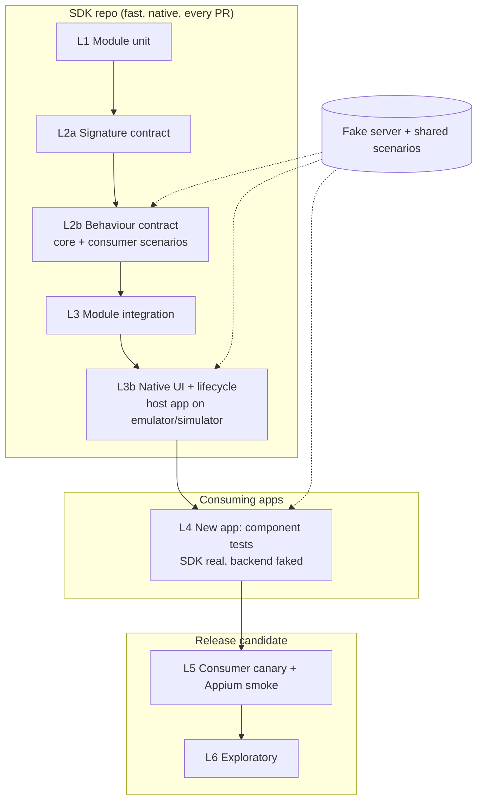
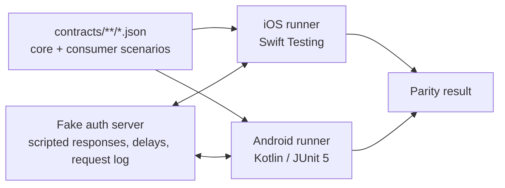
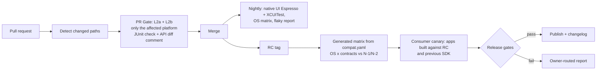

# Mobile SDK Quality Engineering – Proposal

**Role:** Senior Mobile QA Engineer (Platform / SDK) · **Status:** DRAFT v0.2
**Companion files:** [`risk-matrix.md`](risk-matrix.md) (full risk register) · [`slides.md`](slides.md) (short presentation) · code in this repository

---

## 0. Executive summary

**Problem.** Shared SDK modules are consumed by several apps on two native platforms. Quality is mostly checked late and through UI/E2E, so failures are slow to find, hard to attribute, and platform drift goes unnoticed.

**Approach in five points**
1. **Risk first.** Test effort follows *impact × probability* (§2), not equal coverage everywhere.
2. **Push confidence down.** Contracts and module tests give a verdict in minutes; E2E is a thin safety net.
3. **One behavioural spec, two native implementations.** The same scenario files run on iOS and Android, so drift becomes a failing test (§3, §4).
4. **Consumer-driven.** Consuming apps contribute scenarios that live in the SDK repo and block SDK PRs when broken.
5. **Attributable and fast CI.** A generated compatibility matrix, path-filtered device jobs, and flaky tests that are flagged, never silently green (§5).

**Evidence, not only claims.** The example (authentication) is runnable. Running it *found real defects*: concurrent callers triggered duplicate token refreshes on **both** platforms, and Android leaked a `JSONException` on a malformed response that iOS handled correctly. Both are fixed and now locked by shared scenarios. A GitHub repository with five demo PRs shows the PR gate catching API and behaviour regressions in 1.5 to 3 minutes (§4).

---

## 1. Context, assumptions and principles

**Who is involved.** I am the QA of the SDK platform team. The SDK is a set of modules: some owned by my team, some by other teams. It is consumed by **existing apps** (already in production, upgrading at their own pace) and by a **new app** (first release soon, no automation yet). Quality is therefore a shared responsibility: QA owns the strategy, platform and signal; module teams own their tests; app teams own their journeys and their consumer contracts.

**Assumptions** (to be validated in the first two weeks; none is known from the brief):

| # | Assumption | If wrong |
|---|---|---|
| A1 | SDK ships as versioned modules (SPM/CocoaPods, Maven/Gradle), SemVer, each module versioned independently | Add a release-train step to the compatibility policy (§5) |
| A2 | ~3 consuming apps (2 existing, 1 new); apps pin exact SDK versions and upgrade every 1–3 releases | Fewer apps: canary becomes the main gate; more apps: contract layer matters even more |
| A3 | Native implementation per platform, no shared behavioural spec today | If shared code (KMP) exists, parity risk drops and L2b focuses on the bridge |
| A4 | Existing automation is mostly UI/E2E, run nightly, with no flake data | Priority 1 gives the real numbers and re-scores the risks |
| A5 | Release cadence ~every 2–4 weeks; apps ship on their own train | Gates and time budgets stay, only cadence of RC changes |
| A6 | SDK ships some UI (login, consent screens) and handles session/lifecycle | If headless, L3b shrinks to lifecycle only |
| A7 | A device farm (BrowserStack/Firebase/AWS) is available on budget; no in-house device lab | Real-device coverage is cut to a smaller, pre-agreed set |

**Principles:** (1) risk drives coverage · (2) one spec, two implementations · (3) every failure is attributable to module, version and cause category · (4) E2E is a safety net, not the main signal · (5) quality is a conversation as much as a pipeline: ownership, contracts and communication are part of the strategy (§8).

---

## 2. Risk assessment (drives everything else)

**Key message:** the highest risks are *change* risks (breaking consumers, platform drift, version mismatch, concurrency), not feature bugs, so the strategy invests in contracts and compatibility rather than more UI tests.

Scores are expert judgement (no incident history exists) and are re-scored from real data in Priority 1. Full register, failure-mode analysis and coverage-per-zone: [`risk-matrix.md`](risk-matrix.md).

| ID | Risk | I×P | Zone | Primary control |
|---|---|---|---|---|
| R1 | API/behaviour change breaks consuming apps | 5×4=**20** | CRITICAL | L2a signature + L2b consumer contracts |
| R2 | iOS/Android behave differently | 4×4=**16** | CRITICAL | Shared scenarios, parity gate |
| R4 | Incompatible module/dependency versions | 4×4=**16** | CRITICAL | `compat.yaml` matrix, contracts vs N-1/N-2, canary |
| R5 | Concurrency/init-order at module boundaries | 4×4=**16** | CRITICAL | Parallel scenarios, TSan, pair integration |
| R3 | Token lifecycle defects | 5×3=**15** | CRITICAL | Auth scenarios + L3b lifecycle |
| R8 | Flaky/slow tests erode trust | 3×5=**15** | CRITICAL | Retry-and-flag, quarantine, PR budgets |
| R7, R9, R10, R6 | OS upgrades · UI/lifecycle · backend errors · insecure storage | 10–12 | HIGH | OS matrix, L3b, fake-server scenarios, secure store |
| R14 | Upgrade breaks stored session / data migration | 4×3=**12** | HIGH | Previous-release fixtures, upgrade-in-place test (§3) |
| R15 | OEM/device-specific behaviour (battery limits, keystore, low memory) | 3×4=**12** | HIGH | T2 real-device tier on RC (§3) |
| R11–R13 | Performance · log PII · accessibility | 6–9 | MEDIUM | RC budget, redaction test, exploratory |

**How the zone sets test density:** CRITICAL = contract + integration + native UI + canary + exploratory every release; HIGH = contract/happy-path + key errors, smoke canary; MEDIUM = happy path, exploratory on change.

---

## 3. Test strategy

**Key message:** native, fast levels at the base; contracts as the backbone; slow cross-app tests only where they cover a risk nothing below can.

| Level | Scope | Tooling | Runs | Target* | Risks |
|---|---|---|---|---|---|
| L1 Module unit | One module, mocked boundaries | XCTest / JUnit + MockK | Every PR | < 3 min | R3, R12 |
| **L2a Signature contract** | Public API surface: no unintended source/binary break | Android `binary-compatibility-validator`; iOS `.swiftinterface` diff + `swift-api-digester` | Every PR | < 2 min | R1 |
| **L2b Behaviour contract** | Shared scenarios + scenarios contributed by each consuming app | Declarative JSON + fake server, native runners | Every PR | < 5 min | R1, R2, R3, R5, R10 |
| L3 Module integration | Two+ modules, real DI, fake backend | XCTest / JUnit (JVM) | Affected pairs on PR, all pairs nightly | < 10 min | R4, R5 |
| **L3b SDK-native UI + lifecycle** | SDK screens and native lifecycle in a host app inside the SDK repo | Espresso / XCUITest | PR when UI/storage/session paths change; nightly full | < 10 min | R6, R7, R9 |
| L4 New app | Component/screen tests, SDK real, backend faked | XCUITest / Espresso, snapshots | PR | < 15 min | R9 |
| L5 Consumer canary | Real apps built against the RC, few journeys | Appium | RC / nightly | < 30 min | R1, R4 |
| L6 Exploratory | Charters: new capability, OS betas, poor networks, interruptions | Manual, session-based | Per release | timeboxed | R7, R13 |

\*Target times are working assumptions, calibrated against the baseline (Priority 1).

**Contracts for an SDK**
- **Signature contract (L2a):** public API dumped to a versioned file (`.api`) or diffed against the last release. CI fails on an undeclared change; breaking changes require a major bump (SemVer).
- **Consumer-driven behaviour contract (L2b):** Pact's idea applied in-process. Each app contributes scenarios describing *how* it relies on the SDK (e.g. "a valid token is reused without a server call"). They live in `contracts/consumers/<app>/`, run in SDK CI, and `CODEOWNERS` makes each consuming team owner of its folder.
- **Policy:** a failing consumer scenario blocks the SDK PR; unblocked by the owning team's approval or a major bump with migration notice.
- **Trade-off:** more friction on SDK PRs, but feedback in minutes and a smaller, faster canary. Pact with a broker is a later option; it is HTTP-centric and adds infrastructure.

**SDK-native layer (L3b).** An SDK that ships screens or reacts to lifecycle cannot be trusted on logic tests alone. L3b runs the SDK in a minimal host app on an emulator/simulator: SDK-rendered UI, recreation/rotation, background→foreground, termination and relaunch (session restored from storage), secure storage on a real OS. It is *not* E2E: backend is the fake server, only the SDK's surface is driven, a handful of deterministic tests per capability (idling resources, never sleeps). Visual regressions and OEM quirks belong to exploratory or device-farm work.

**Native vs cross-platform.** L1–L4 are native (fidelity, speed, no abstraction leaks). Appium appears only at L5 for a few critical journeys (login, core flow, upgrade path).

**Regression in the consuming apps (L4/L5).** The SDK team does not own the apps' suites, but depends on them to see integration breakage. Existing apps and the new app need different treatment:

| | Existing apps (in production) | New app (pre-release) |
|---|---|---|
| Starting point | Have regression suites, unknown health | No automation, highest uncertainty |
| What the SDK team asks | A small *SDK-facing smoke* tagged `@sdk-smoke` (login, session restore, one flow per module), runnable against any SDK build | Same smoke from day one, written together with the app team; plus component tests with SDK real and backend faked (L4) |
| When it runs | On the RC and nightly, in the app's own pipeline, with the SDK version as an input | On every app PR touching SDK usage, and on the RC |
| Failure ownership | App team triages first, uses my report to decide SDK vs app; differential run (RC vs previous SDK) | QA of the SDK team pairs with the app team until the suite is stable |
| Why | Avoid regressions in revenue-bearing flows | Highest risk: first real integration of every module in one app |

The new app is the *best* early signal for the SDK: it exercises the newest modules and the combination nobody has run before. I would embed in that team for the first release.

**Device and OS coverage.** OS versions come from `compat.yaml` (min/max on PR, full list on RC). Devices are chosen by risk, not by count:

| Tier | Where | What | Why |
|---|---|---|---|
| T0 | Simulator/emulator, every PR | Min and max supported OS, one phone form factor | Fast and cheap; catches logic and lifecycle |
| T1 | Simulator/emulator, nightly | Full OS list, tablet/foldable sizes, dark mode, large font, RTL | Layout and OS-behaviour drift (R7) |
| T2 | Real devices (farm), RC only | Android: Samsung (One UI), Xiaomi/Redmi (MIUI/HyperOS), Pixel, one low-RAM device (≤3 GB); iOS: oldest supported device, current and previous OS, one small screen | OEM battery/background limits kill processes and clear state; keystore/Keychain and biometrics differ on real hardware; memory pressure |
| T3 | Exploratory by hand, RC | Real network switching, interruptions, OS beta | What automation cannot simulate faithfully |

The device list is data-driven: top devices and OS versions by active users from app analytics, reviewed each quarter. Without analytics, I start with Android market-share leaders in the target regions and the two latest iOS majors.

**Automated vs exploratory vs manual.** Automation checks what we already know; exploratory finds what we do not. Both are scheduled, not ad hoc.

| Type | When | Who | Charters (examples) | Output |
|---|---|---|---|---|
| Exploratory, session-based (60–90 min, charter, notes) | Per RC, and when a new module or major capability lands | QA + a developer from the module team (pairing) + one app-team member | New module in the new app · session expiry mid-flow · airplane mode and network switch during refresh · app killed during login · OS beta · backgrounding with OEM battery saver on · accessibility (VoiceOver/TalkBack, font scale) · log inspection for PII | Bugs, new scenario candidates for the contracts, charter list for next time |
| Manual regression checklist (short, risk-ranked) | Per RC on real devices (T2) | QA | ~20 checks: login, restore, logout, token expiry, upgrade-in-place, deep link, permissions, low memory, rotation | Pass/fail per device; anything repeated twice becomes automated |
| Bug bash | Before the new app's first release | Everyone touching the SDK and the app | Free exploration with prizes and a shared sheet | Fresh-eyes defects; usability issues |

**Rule:** any defect found manually leads to a regression check at the lowest sensible level (usually a scenario in L2b); exploratory should *shrink* over time for known areas and move to new ones.

**Upgrade and data migration (R14).** Apps upgrade the SDK; users upgrade the app with a session already stored. A change of storage format, key alias or Keychain accessibility can log everyone out or crash on launch. Controls:
- **Persisted-state fixtures:** the contract suite includes a stored session written by the *previous* release (golden file / Keychain item / `SharedPreferences` blob); the new version must restore it or migrate it explicitly.
- **Upgrade-in-place test (L5, RC):** install the app with SDK N-1, log in, install over it with SDK N, assert session still valid. Android via `adb install -r`, iOS via simulator install over.
- **Downgrade/rollback note:** if a storage format changes, the release notes say whether rollback is safe.
This is described, not implemented in the demo; the auth example shows where the fixture would plug in (§4).

---

## 4. Automation example – Authentication

**Key message:** one contract, two native runners; adding a case is one JSON edit, and platform drift becomes a failing test.

**Why auth:** CRITICAL on R3, consumed by every module, and its error semantics silently diverge between platforms.

- Each scenario scripts the fake server (status, body, optional `delayMs`), optional client config (`timeoutMs`), steps (including `parallel` calls), expected results/errors, and final state (authenticated, number and shape of requests).
- Error names are part of the contract: `invalidCredentials`, `sessionExpired`, `serverError`, `networkError`, `notAuthenticated`.
- **Scenarios (10 per platform):** login, invalid credentials, transparent refresh, rejected refresh ends session, 503 during refresh keeps session, timeout keeps session, malformed body → `serverError`, **concurrent refresh is single-flight**, logout, and one consumer scenario (token cached between calls).
- No sleeps: expiry is driven by `expires_in`; slowness by scripted `delayMs`.

**What the example proved** (`./run_all.sh`, `./run_native.sh`)

| Check | Result |
|---|---|
| 10 contract scenarios, iOS and Android | pass on both |
| Concurrent refresh (new scenario, before fixing the code) | **failed on both** (duplicate refreshes) → fixed: Swift in-flight task, Kotlin lock |
| Malformed body (new scenario, before fixing) | **failed on Android only** (`JSONException` escaped) → mapped to `serverError` |
| Injected iOS-only bug (503 treated as session expiry) | caught by `server_error_keeps_session` |
| Added public Kotlin symbol | `apiCheck` fails with the exact diff until `apiDump` is reviewed |
| Renamed public Swift parameter label | `tools/ios_api.sh check` shows the exact diff; `swift-api-digester` classifies it as a rename (breaking) |
| L3b native tests: 4 Espresso + 4 XCUITest | pass locally (API 36 / iOS 18) and on GitHub-hosted runners (Android API 29 and 36, iOS 18.5); iOS 26.2 failed once and was not investigated |
| Keychain replaced by in-memory store | relaunch test fails (test is sensitive) |

**Quick-feedback evidence: five demo pull requests on GitHub** (private repo `ricardorlg/sdk-qa-assignment`). Each changes one thing; the PR gate reports which layer catches it, in about 1.5 to 3 minutes, and only runs the platform whose paths changed.

| PR | Platform | What it breaks | L2a signature | L2b behaviour | Why |
|---|---|---|---|---|---|
| #1 | Android | public `login` renamed to `signIn` | **fails** (`apiCheck` diff) | fails (runner no longer compiles) | breaking API change |
| #2 | iOS | single-flight refresh removed (internal) | passes | **fails** (`concurrent_refresh_is_single_flight`) | signature unchanged, behaviour regressed; Android still green, so the bug is iOS-only |
| #3 | iOS | new public property `hasSession` | **fails** (diff) | passes | additive change: needs review, digester does not call it breaking |
| #4 | Android | refresh lock removed (internal) | passes | **fails** | same bug class as #2, on Android |
| #5 | iOS | `KeychainSessionStore.init(service:)` becomes `init(keychainService:)` | **fails** | passes | `swift-api-digester` vs tag `v1.0.0`: "init(service:) has been removed" (breaking) |

What this shows: signature checks (L2a) and behaviour contracts (L2b) catch different things and both are needed (#2 and #4 are invisible to L2a; #3 and #5 are invisible to L2b). L2a diffs are posted to the job summary and as a sticky PR comment; test results appear as a JUnit check.

**Limitations:** `AuthClient` classes are minimal stand-ins; Android store uses `SharedPreferences` (not Keystore); the Android cold-start test simulates a new process; iOS API check uses a committed `.swiftinterface` baseline plus `swift-api-digester` (SwiftPM's `diagnose-api-breaking-changes` does not support iOS targets); the baseline text depends on the Xcode version, so it is regenerated from the CI toolchain (`macos-26`) and a toolchain upgrade means a reviewed baseline update; the digester runs in ABI mode and its "new API without @available" notices are ignored because additive API is not breaking; Swift Testing reports the 10 scenarios as one parameterised test in JUnit, so the failing scenario is read from the log; real devices and other OEM emulators are not covered (described in §3, not built).

---

## 5. CI/CD and release validation (GitHub Actions)

**Key message:** fast, blocking gates on every PR; breadth (matrix, canary, full device set) on nightly and release candidates; every failure carries an owner and a cause category.

Implemented as three staged workflows in `.github/workflows/`, one per stage of the cycle:

| Workflow | Trigger | Content | Status |
|---|---|---|---|
| **PR Gate** (`pr.yml`) | every PR | path-aware: Android job only if `android/**` changed, iOS job only if `ios/**` changed, both if `contracts/**` or the fake server changed. Each runs L2a and L2b (L2b still runs when L2a fails), publishes a JUnit check, a job summary and a sticky comment with the API diff | verified on GitHub (`ubuntu-latest`, `macos-26`), see the demo PRs in §4 |
| **Native UI** (`ui-native.yml`) | nightly, manual | Espresso and XCUITest over the OS matrix in `compat.yaml`; flaky report artifact | ran once: Android API 29/36 and iOS 18.5 passed (6 to 11 min), iOS 26.2 failed after 16 min and has not been diagnosed |
| **Release Validation** (`release.yml`) | tag `rc-*`, manual | PR gate, then native UI matrix, then contract-vs-previous-releases and consumer canary | gate and UI reuse the other workflows; the last two jobs are specified stubs |

UI tests are deliberately not a PR gate (6 to 16 minutes per job). Actions are on their latest major versions (checkout v7, setup-node v7 on Node 24, setup-java v6, upload-artifact v7, gradle v6); the macOS runner is `macos-26`, the newest label GitHub offers today.

**PR gates (blocking, target < 15 min; measured 1.5 to 3 min for the implemented subset):** **L2a** unreviewed API change fails · **L2b** failing consumer scenario blocks · a change to `contracts/` runs both platform runners (parity gate) · path-based selection with `dorny/paths-filter`. Planned but not built: lint, L1 and L3 for affected modules. L3b native UI is not a PR gate; it runs nightly and on RC, and could be made a PR gate for UI/storage/session paths once its duration is acceptable.

**Release gates (blocking):** all L1–L3 green and no quarantined test on changed modules · compatibility matrix green · every in-scope consumer app builds and passes smoke against the RC · zero open P1/P2 regressions · coverage and mutation score on changed code do not drop (ratchet).

**Compatibility validation**
- `compat.yaml` is the source of truth; `tools/gen_matrix.py pr|rc` expands it: min/max OS on PR, full OS list plus contracts-vs-previous-releases plus canary on RC. It also rejects an app pinning an unknown module.
- **Differential canary:** build each app with the RC *and* the previous SDK; failing only on the RC isolates SDK regressions from app changes.

**Versioning and compatibility policy (assumed, to be agreed with the platform lead)**
- **SemVer per module.** Public API/behaviour break = major; additive = minor; fix = patch. L2a decides this mechanically: an API diff with removals or renames cannot ship as minor/patch.
- **SDK umbrella version** pins a tested set of module versions (a *known-good set*); `compat.yaml` is that set plus the OS ranges. Apps pin the umbrella, not individual modules, unless they opt out and accept the risk.
- **Support window:** N and N-1 majors fully supported, N-2 security fixes only; every supported combination appears in the contract-vs-release matrix. Anything outside is "unsupported", stated in the published matrix.
- **Deprecation:** deprecated API stays one minor release with a compiler warning and a migration note before removal in the next major; apps are told at deprecation, not at removal.
- **Cross-module rules:** a module declares the module and OS versions it needs; CI rejects a graph that violates them (`gen_matrix.py` already rejects unknown pins).
- **Published matrix + changelog:** every release publishes what changed, who is affected (consumer scenarios that were touched), supported OS/module combinations, and whether storage formats changed (R14).
- **Hotfix and rollback:** a patch can be cut from the last release tag; the previous umbrella version stays downloadable; the upgrade test (§3) says whether rollback is safe.

**Slow or unstable tests**
- `tools/retry_flag_flaky.sh`: retry once; pass-on-retry is reported as FLAKY (warning + artifact), never silently green.
- Auto-quarantine after a flake-rate threshold: non-blocking, with an owner and a 2-week expiry (fix or delete).
- Slow tests move down the pyramid or to nightly; each stage has a time budget.

**Communicating failures:** every report states module + version, platform, cause category (product / dependency / test / environment), first-bad-commit when bisectable, and artifacts (logs, network trace, device info, seed). Routed by CODEOWNERS; a sticky PR comment (API diff) and a JUnit check for PRs, Slack for nightly/RC (not set up); one dashboard for flake rate, duration and gate pass rate.

---

## 6. Investigation – module 3.4 → 3.5 (Android green, iOS intermittent, only A+B together)

**Key message:** do not start from a theory. Start from the symptoms, collect evidence that survives the next run, make the failure reproducible, then change *one variable at a time* until each of the four causes (product, dependency, test, environment) is either confirmed or ruled out with data.

**What the symptoms already tell us**

| Symptom | What it suggests | What it does not prove |
|---|---|---|
| Android green | Likely iOS-specific code, runtime or toolchain; shared backend/spec less likely | That Android is correct (it may be hiding the same race) |
| Only with A+B together | An interaction: shared state, ordering, resource or version conflict | Which of the two modules is at fault, or that either alone is fine under load |
| Intermittent, re-run sometimes passes | Non-determinism: timing, ordering, shared state, resource pressure, or a flaky environment | That it is a race; a flaky runner looks the same |
| Neither team can reproduce alone | Needs the combined setup, or depends on the CI environment | That the bug is in CI; local setups usually differ in speed, OS and cache |

**Candidate causes (kept open; each has an experiment below):** concurrency/init-order at the A/B boundary · shared singleton or global state · a behavioural change in 3.5 (threading, retries, timing) · a different transitive dependency resolved only in some builds · test ordering, shared state or clock in the test itself · runner/simulator/Xcode/OS differences or load. My working bet is concurrency (it fits all four symptoms and the auth example showed this class is real), but **the plan does not depend on it**.

### Step 0 – Contain and organise (first hour)
- **Contain:** decide with the release manager whether 3.5 is held back, pinned to 3.4 for affected apps, or shipped with a known-issue note; mark the failing test *known-flaky with owner* instead of retrying blindly.
- **One owner and one channel:** a single investigation thread with both module teams, the platform CI owner and an iOS dev; two teams that each "cannot reproduce" is a coordination problem as much as a technical one.
- **Define the failure precisely:** one-line failure signature (test, assertion, error text), so every run can be classified automatically.

### Step 1 – Collect diagnostics (before changing anything)
Make every run, red or green, leave the same evidence, so the failing run is never lost.

| Evidence | How | Answers |
|---|---|---|
| Failure rate and distribution | Last 30–60 days of CI history; per runner, OS, Xcode, test, time of day | Is it new in 3.5? Correlated with an environment? |
| Exact inputs of each run | Commit, `Package.resolved`, module versions, Xcode, simulator runtime, device model, runner image, parallelism, test order, random seed | What differs between red and green |
| Test artifacts | `.xcresult`, `xcodebuild` log, crash/`.ips` logs, simulator system log (`log collect`), screenshots/video | What happened in the failing run |
| Behaviour trace | Structured SDK logs with timestamps, thread/queue id, module and request id; `os_signpost` around A/B initialisation and calls | Ordering and timing across A and B |
| Network trace | Fake-server request log (`/__requests`), proxy capture if real backend | Duplicated, reordered or missing requests (the auth bug looked like this) |
| Sanitizer output | Thread Sanitizer (TSan), Address Sanitizer, Main Thread Checker | Data race, memory error, UI off main thread |
| Resource state | CPU, memory, simulator boot time, disk, parallel jobs on the runner | Failure only under load |
| Dependency diff | `swift package show-dependencies` / `Package.resolved`, `gradle dependencies` for 3.4 vs 3.5 | Silent transitive change |

**Rule:** capture these in CI by default (artifact upload on failure, run-metadata file per job), so the next occurrence arrives already instrumented.

### Step 2 – Reproduce on demand
The goal is a failure rate high enough to compare experiments (for example ≥ 20%).
1. **Smallest combined harness:** a test target that loads only A 3.5 + B and runs the failing scenario in a loop; keep CI's exact toolchain via a pinned container/runner image or the same Xcode and simulator runtime.
2. **Repeat to measure rate:** `xcodebuild test -run-tests-until-failure -test-iterations 200` (or an equivalent loop), recording each outcome; always report *failures/runs*, never "it passed".
3. **Amplify without changing semantics:** TSan, serial vs parallel execution, shuffled order, throttled CPU or slow simulator, injected delays in callbacks and network, run under memory pressure, vary initialisation order of A and B explicitly.
4. **Try the failing environment, not just mine:** run the harness on the CI runner image, on a clean simulator, and on a warm one.

### Step 3 – Isolate: change one variable at a time
Each experiment has a predicted outcome for each cause, so the result discriminates instead of just "feeling" informative.

| Experiment | If result is… | Points to |
|---|---|---|
| A 3.4 + B vs A 3.5 + B, same environment, 100+ runs | Rate jumps only with 3.5 | **Product** (change in A 3.5); then bisect commits between tags |
| B changed to its previous release with A 3.5 | Failure disappears | **Product, in the interaction** (B relies on behaviour A changed) |
| Pin all transitive dependencies to the 3.4 graph while using 3.5 code | Failure disappears | **Dependency** (a transitive version moved) |
| Diff resolved graph between red and green runs | Different versions only in red runs | **Dependency** (unpinned resolution) |
| Same code, TSan enabled | Reports a race at the A/B boundary | **Product** (concurrency); a TSan-clean run lowers but does not remove the likelihood |
| Run test alone, in different order, with `--no-parallel`, with a fresh simulator per run | Rate drops with isolation or depends on previous tests | **Test** (shared state, ordering, leaked singleton or clock) |
| Same commit on another runner, Xcode, simulator runtime, or cold vs warm simulator | Rate follows the runner/runtime, not the code | **Environment** |
| Fail with injected deterministic delay at a suspected point | Becomes 100% reproducible | **Product** (race confirmed; delay amplifies the window) |
| Never fails after N runs (e.g. 300) in any variation | Not reproducible: raise N, widen environments, or stay in monitoring with extra diagnostics | **Unresolved**; do not close as "fixed" |

**Bisect:** when 3.4 → 3.5 is the only difference, use `git bisect run` with the repeat-N harness as the probe; for non-deterministic failures a "good" commit needs enough passing runs to be believable (for a rate of *p*, about 3/*p* runs for 95% confidence, e.g. a 14% failure rate needs ≥ 22 clean runs).

**Cause signatures at a glance**

| Cause | Typical signature | Typical counter-evidence |
|---|---|---|
| Product | Reproduces on any machine with the right inputs; TSan or logs show the interaction; rate changes with the code version | Same on 3.4 |
| Dependency | Differs by resolved version; may appear only on fresh resolution; clean cache changes the result | Identical lockfile in red and green |
| Test | Depends on order, shared state, time, test data or parallelism; passes in isolation | Reproduces in a production-like harness with isolation |
| Environment | Correlates with runner, image, Xcode, simulator, load or time of day; disappears elsewhere | Same failure across runners and machines |

### Step 4 – Diagnose, fix and confirm
- Turn the root cause into a **deterministic failing test** (forced interleaving, injected scheduler, fake clock) so it no longer depends on luck.
- The owning module team fixes; QA verifies with a statistical bar: the same repeat-N harness shows 0 failures over a count chosen from the observed rate, in the failing environment.
- Write down what was *ruled out*, not only what was found; it speeds up the next investigation.

### Step 5 – Prevent recurrence
- **Detection:** the failing scenario joins the L3 pair suite, and the shared contract (Android runs it too, which settles the parity question); nightly pair run with TSan and repeat-N for all affected pairs.
- **Dependency hygiene:** commit lockfiles, diff the resolved graph in every PR, and fail on unexpected transitive changes.
- **Release gate:** any module bump triggers the pair-compatibility job for every module that depends on it; a failing pair blocks the release train, not just the module.
- **Contract:** document and test threading and init-order guarantees as part of the module's public contract.
- **Diagnostics by default:** run metadata and artifacts uploaded on failure; flaky tests auto-flagged (§5) with owner and expiry.
- **Process:** blameless post-mortem with root cause, why it escaped (which level should have caught it), and one new test at the lowest sensible level.

**Communication:** I report on a fixed template (symptoms, evidence, hypotheses ruled in/out, next experiment, owner) in the shared thread; each update states what changed in the failure *rate*, so the two teams see the same facts.

---

## 7. First three priorities

**Assumption:** some automation exists (mostly UI/E2E), there is no platform-level strategy, and I join as the QA for the SDK platform.

**First 30 days: listen before changing.** Meet each module lead, the platform lead, the release manager and one person per consuming app (including the new app). Ask: what broke in the last 3 releases, what do you not trust, what slows you down. Map ownership, build a one-page view of modules, apps, versions and pipelines, and read the last 30–60 days of CI. Priorities below are provisional until this is done and the risk register is re-scored from real data.

| # | Priority | Why | Information needed | People | First useful outcome | Success measure | If not done |
|---|---|---|---|---|---|---|---|
| 1 | **Baseline and visibility** of existing automation (also re-scores the risk register) | Cannot improve or gate what is not measured; every other choice needs these numbers | Test inventory, pass/flake rate, duration, ownership, 30–60 days of CI history, top escaped defects | Module leads, devs, CI/release owner | ~2 weeks: one-page dashboard and a ranked list of the top 10 flaky/slow tests with owners | Every test has an owner; flake rate and time-to-signal are tracked weekly | Effort goes to the loudest problem, not the biggest |
| 2 | **Shared contract layer** (iOS/Android parity), starting with auth | Drift is a main pain point and cheap to catch at contract level | Public API, behaviour docs, past parity bugs, backend/auth contract | iOS and Android SDK devs, auth owners, backend owner | ~4 weeks: auth scenarios in PR CI on both platforms, first parity gaps triaged | Parity gaps found per release; share of public API covered by a scenario | Platform drift keeps reaching apps late |
| 3 | **Compatibility manifest and PR/RC gates** | Version uncertainty and late integration make failures unattributable | Supported version combinations, release cadence, consuming apps and pinning policy | Platform lead, release manager, app teams | ~6 weeks: `compat.yaml` as source of truth, generated RC matrix, first blocking gate with one canary | Escaped integration defects per release; time from failure to owner | Breaking releases reach apps; investigations stay slow |

**Why this order.** (1) gives the data that justifies and sizes (2) and (3). (2) comes before (3) because contracts are the cheapest, fastest signal and the gates in (3) need something reliable to gate on. (3) reuses the ownership map from (1) and the contract jobs from (2). Priorities 2 and 3 can overlap once the baseline shows where the pain is; the order changes if (1) reveals a different top risk (for example a flaky pipeline that blocks every release: fix that first).

**Quick wins in parallel (low effort, visible):** retry-and-flag for flaky tests, run metadata and artifacts uploaded on failure (used again in §6), a release-notes template with "who is affected".

**Intentionally postponed:** broad E2E expansion, full device-farm coverage, performance/security suites beyond the SDK contract, a custom test framework, Pact with a broker. Revisit after the baseline.

---

## 8. Working with the teams (ownership, communication, definition of done)

**Key message:** most integration failures are coordination failures first. The pipeline makes them visible; these agreements prevent them.

**Who owns what**

| Who | Owns | QA's role |
|---|---|---|
| Module teams (mine and others) | Module code, L1/L3 tests, the module's section of the shared scenarios | Provide the platform, templates and review; do not write their tests for them |
| SDK platform team | API surface, L2a/L2b gates, `compat.yaml`, release train | Owner of strategy, matrix, flake dashboard |
| App teams (existing and new) | Their `contracts/consumers/<app>/` files, `@sdk-smoke` suite, app journeys | Pair on first scenarios; triage with them using the failure report |
| Release manager | RC cut, go/no-go | Provide the gate report and risk summary, not the decision |

**Definition of done for a module change** (including modules from other teams): unit tests; contract scenario added or updated for any behaviour a consumer can see; API diff reviewed (`apiDump` / `ios_api.sh dump`); changelog entry with affected consumers; no new flaky test; both platforms covered or an explicit, tracked parity exception.

**Rituals (light, no new meetings if existing ones can be used)**
- **Weekly compatibility triage (30 min):** platform, one rep per module, one rep per app: open breaking changes, upcoming deprecations, matrix changes, top flakes.
- **Contract review in the PR:** a change to a consumer scenario needs the owning app's approval (CODEOWNERS); a change to the public API needs the platform team's.
- **RC readiness check (15 min per RC):** gate report, open P1/P2, exploratory results, go/no-go input.
- **Blameless post-mortem** for every escaped defect: detection gap → new test at the lowest level.
- **Channels:** one SDK-release announcement channel (what changed, who must act); one #sdk-quality channel for flake and CI health.

**Handling disagreement.** If a module team thinks a consumer scenario over-specifies behaviour, the discussion happens in the PR with the app team; the default is to keep the scenario until agreed otherwise, and any override is recorded with an expiry date.

**Quality metrics reported monthly** (kept few): escaped defects per release by module, gate pass rate and time-to-signal, flake rate, % of public API covered by a scenario, supported-matrix coverage. Used to re-score the risk register, not to rank teams.

---

## 9. Risks, trade-offs and AI usage

**Risks and mitigations**
- *Contract friction* (blocked SDK PRs) → few, behaviour-focused scenarios, clear ownership, documented override.
- *Over-specification* (freezing incidental behaviour) → only user-visible semantics belong in scenarios.
- *Emulator cost/flakiness* → path filters, idling resources, quarantine.
- *Unknown starting point* → Priority 1 first; targets and risk scores are provisional.
- *Adoption* → module teams own their tests; QA provides platform, tooling and signal.

**Trade-offs:** native runners over one cross-platform framework (fidelity vs duplication, contained by shared scenarios) · in-process consumer contracts over Pact+broker (cheaper now) · fewer deterministic gating tests over breadth (breadth moves to nightly/exploratory) · reference clients are simplified stand-ins.

**Assumptions to validate:** module ownership, number of consuming apps and pinning policy, release cadence, whether the SDK ships UI (L3b applies only then).

**AI usage.** GitHub Copilot was used as a pair to draft structure, scaffold the example (fake server, Swift/Kotlin runners, host apps, CI workflow) and iterate on wording. Approach, scope, risk scores and priorities were decided by me in dialogue. Output was validated rather than trusted: all tests were executed, and sensitivity was proven with deliberate faults (iOS-only 503 bug, API change, Keychain→memory store), each caught by the intended test. New scenarios were written first and run against unfixed code, which surfaced two genuine defects. The CI was run on GitHub-hosted runners and iterated until the PR gate was green; five demo PRs show which layer catches which change (§4). Anything not exercised (iOS 26.2 UI run, canary and previous-release jobs, real devices, most time targets) is labelled as such.

**References:** Semantic Versioning 2.0 (semver.org) · Kotlin `binary-compatibility-validator` · Android *Testing strategies* (test pyramid, fidelity, cost of a bug) · Fowler, *The Practical Test Pyramid* · Satisfice HTSM (risk lens) · ISTQB risk-based testing practice.
