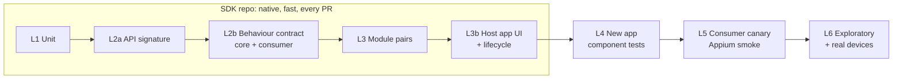
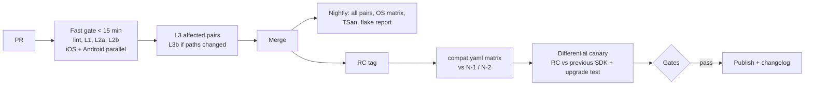

# Mobile SDK Quality Engineering
### Risk-based test strategy · Senior Mobile QA Engineer (Platform / SDK)

**Situation.** Shared SDK modules (some from other teams), iOS + Android, used by existing apps and a new app. Pain: module updates ripple to others · iOS ≠ Android · slow, flaky E2E · unclear version compatibility · late, hard-to-attribute failures.

**Approach**
1. **Risk first:** effort follows impact × probability; top risks are *change* risks (R1 API break 20, R2 platform drift 16, R4 version mismatch 16, R5 concurrency 16)
2. **Push confidence down:** contracts and module tests answer in minutes; E2E is a thin safety net
3. **One behavioural spec, two native implementations; consumer-driven** (apps contribute scenarios that block SDK PRs)
4. **Attributable, fast CI:** generated compat matrix, flaky tests flagged, owner on every failure

<span class="small">Assumptions: SemVer modules pinned by apps · ~3 apps (2 existing, 1 new) · release every 2–4 weeks · device farm available · mostly UI/E2E automation today · SDK ships some UI. Each is validated in week 1–2 (full list in the document).</span>

---

# 1 · Test strategy and architecture



| Need | Answer |
|---|---|
| Module A breaks B or an app | **L2a** `apiCheck` / `.swiftinterface` diff + `swift-api-digester`; **L2b** consumer scenarios in SDK CI (CODEOWNERS, block the PR) |
| iOS ≠ Android | Same JSON scenarios run by both native runners; drift = failing test |
| Real-world coverage | L3b harness app (Espresso/XCUITest), `@sdk-smoke` in each app (old + new), real-device tier on RC (Samsung, Xiaomi, Pixel, low-RAM, oldest iPhone), scheduled exploratory charters, upgrade test N-1→N |

<span class="small">Native for L1–L4 (fidelity, speed); Appium only for a few L5 journeys. Time targets are assumptions calibrated by the baseline.</span>

---

# 2 · Automation example: authentication (runnable)

```json
{ "id": "concurrent_refresh_is_single_flight",
  "tokenEndpointResponses": [ {"status":200,"body":{"access_token":"a1","refresh_token":"r1","expires_in":0}},
                              {"status":200,"delayMs":200,"body":{"access_token":"a2","refresh_token":"r2","expires_in":3600}} ],
  "steps": [ {"action":"login", ...},
             {"action":"parallel","calls":[ getAccessToken→"a2", getAccessToken→"a2", getAccessToken→"a2" ]} ],
  "final": { "tokenRequests": 2, "lastRequestGrantType": "refresh_token" } }
```

`scenarios.json` → **Swift runner** + **Kotlin runner** → fake auth server (scripted, records requests). 10 scenarios per platform.

| Evidence that it works | Result |
|---|---|
| New scenarios run **before** fixing | Concurrent refresh **duplicated on iOS and Android**; Android leaked `JSONException` on a malformed body |
| Injected faults (503 = session expired, API change, Keychain → memory) | Each caught by the intended test; Android/iOS API diff shows exact line |
| L3b native | 4 Espresso + 4 XCUITest incl. kill and relaunch |

---

# 3 · CI/CD and release validation (GitHub Actions)



- **Compatibility:** `compat.yaml` is the source of truth; SemVer per module, umbrella version = known-good set, support N and N-1, one-minor deprecation; release notes list affected consumers
- **Slow/unstable tests:** pass-on-retry is **reported as FLAKY**, quarantine with owner + 2-week expiry, time budget per stage
- **Failures:** module, version, platform, cause category, artifacts, routed by CODEOWNERS
- **Safe adoption:** apps pin versions, see the matrix and changelog, run `@sdk-smoke` against the RC before upgrading

---

# 4 · Investigation: 3.4 → 3.5, iOS-only, intermittent, A+B only

**Evidence first, theory second.** Symptoms say: iOS-specific · an interaction · non-deterministic · needs the combined setup.

0. **Contain:** one owner and channel, hold/pin 3.5, precise failure signature
1. **Collect:** run inputs (commit, `Package.resolved`, Xcode, runtime, runner, order, seed), `.xcresult`, logs with thread ids, TSan, network trace, resource load. Always on in CI.
2. **Reproduce:** minimal A+B harness, repeat-N, report failures/runs; amplify with delays, serial/shuffled order, slow simulator
3. **Isolate:** one variable at a time

| Cause | Signature | Key experiment |
|---|---|---|
| Product | Follows the code; TSan/logs show interaction | A 3.4 vs 3.5, B previous, bisect |
| Dependency | Follows the resolved graph | Pin transitives, diff `Package.resolved` |
| Test | Follows order, state, clock | Isolate, shuffle, fresh simulator |
| Environment | Follows runner/Xcode/simulator/load | Same commit elsewhere |

**Fix and prevent:** deterministic failing test → fix → clean repeat-N sized from the failure rate → pair suite + shared scenario, nightly TSan, lockfile diff, documented threading contract, post-mortem.

---

# 5 · First three priorities

**First 30 days: listen** (module leads, release manager, each app team), map ownership, read CI history, re-score risks.

| # | Priority | Why / need / who | First outcome | Success |
|---|---|---|---|---|
| 1 | **Baseline + visibility** | Cannot gate what is not measured · test inventory, 30–60 days CI, escaped defects · module leads, CI/release owner | ~2 wks: dashboard, top-10 flaky/slow list with owners | Every test owned; flake rate tracked |
| 2 | **Shared contract layer**, auth first | Drift is cheapest to catch here · public API, past parity bugs · iOS + Android devs, auth owners | ~4 wks: auth scenarios in PR CI on both platforms | Parity gaps found; API covered by scenarios |
| 3 | **Compat manifest + PR/RC gates** | Version uncertainty makes failures unattributable · supported combos, cadence, pinning · platform lead, release mgr, app teams | ~6 wks: `compat.yaml`, generated matrix, first blocking gate + 1 canary | Escaped integration defects; time to owner |

**Order:** data → cheapest signal → gates (changes if the baseline shows another top risk). **Quick wins:** retry-and-flag, artifacts on failure.
**Postponed:** broad E2E, full device farm, custom framework, Pact broker.

---

# Assumptions, risks, trade-offs, AI usage

| Risk | Mitigation |
|---|---|
| Contract friction on SDK PRs | Few, behaviour-focused scenarios; clear ownership; override with expiry |
| Over-specifying behaviour | Only user-visible semantics in scenarios |
| Emulator cost/flakiness | Path filters, idling resources, quarantine |
| Unknown starting point | Baseline first; targets and risk scores are provisional |

**Trade-offs:** native runners over one cross-platform framework (fidelity vs duplication, contained by shared scenarios) · in-process consumer contracts over Pact + broker (cheaper now) · fewer gating tests, breadth moves to nightly/exploratory.

**Not done:** GitHub-hosted runs (workflow validated locally), canary and previous-release jobs (stubs), upgrade test (specified), real-device tier. Clients are simplified stand-ins.

**AI usage:** GitHub Copilot as a pair for structure and scaffolding; approach, scope and priorities decided in dialogue. Validated by running every test and injecting faults, and by writing new scenarios first against unfixed code (found two real bugs).

<span class="small">Repository: `sdk-qa-assignment/` · full document `docs/strategy.md` · risk register `docs/risk-matrix.md`</span>
